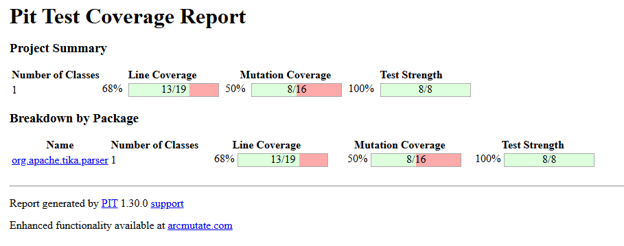
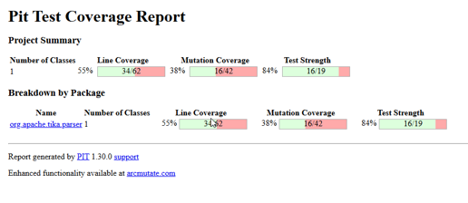
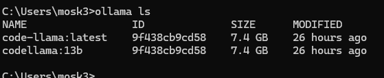
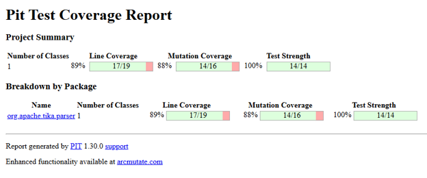
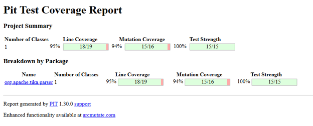
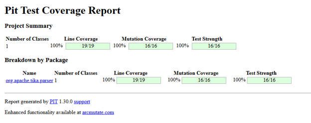
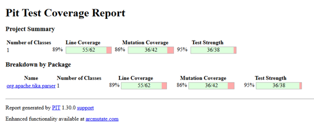
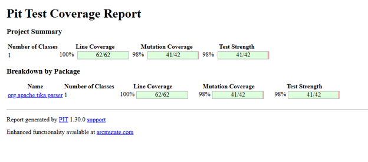
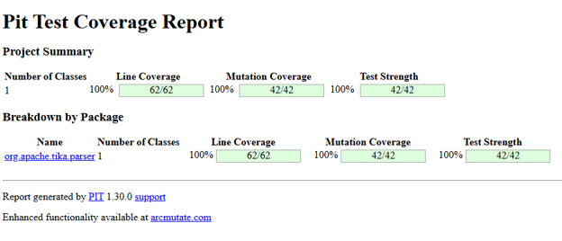

# Tâche 2 - Enric Soldevila - IFT3913

Ce document présente le travail réalisé pour la tâche 2 du cours IFT3913.

## Table des matières

1.  Choix des classes
2.  Génération de tests avec l'IA
3.  Exécution de Pitest
4.  Problèmes rencontrés
5.  Résultats pour `ParserDecorator`
6.  Résultats pour `ParseContext`
7.  Critique qualitative des oracles
8.  Exécution dans la GitHub Action

---

## 1. Choix des classes

Nous avons sélectionné deux classes du module `tika-core` :

- `org.apache.tika.parser.ParserDecorator`
- `org.apache.tika.parser.ParseContext`

Ces classes possèdent déjà des tests, mais ceux-ci ne couvrent pas la totalité du code. Avant toute génération, l'analyse de mutation avec les tests originaux montrait des mutants vivants dans les deux classes :

**ParserDecorator**
Score de mutation : 8/16 (donc 8 mutants)
Lignes courvertes : 13/19


**ParseContext**
Score de mutation : 16/42 (donc 26 mutants)
Lignes courvertes : 34/62


Une part importante des lignes n'est pas couverte, et plusieurs mutants survivent, ce qui signifie que les tests existants ne vérifient pas bien le comportement de ces classes, bien que tous les tests passent.

## 2. Génération de tests avec l'IA (ChatUniTest)

### 2.1 Modèle de langage utilisé

Nous avons d'abord utilisé le modèle ouvert `codellama:13b`, exécuté localement sur notre ordinateur local.


Cependant, vers la moitié des tests, le modèle était très lent et n'arrivait pas à générer des tests, ce qui nous forçait de générer nos tests en mettant une limite d'essaies. Ex: `mvn chatunitest:class "-DselectClass=ParseContext" "-Dthread=false" "-DtestNumber=2" "-DmaxRounds=3"`. Et nous nous retrouvions avec beaucoup de tests impossible à générer.

Nous avons remarqué qu'il était possible de mettre des modèles d'OpenAI hébergé sur le cloud, donc nous avons mis `gpt-4o` pour générer les tests de `ParseContext`.

(PS: La clé privée qui s'est retrouvée par erreur dans les commits a été supprimée et est non fonctionnelle à présent)

### 2.2 Commande utilisée

La génération de tests pour une classe se fait avec la commande Maven suivante :

```
mvn chatunitest:class "-DselectClass=ClassName" "-Dthread=false" "-DtestNumber=2" "-DmaxRounds=3"
```

avec la configuration :

```
<dependency>
	<groupId>io.github.ZJU-ACES-ISE</groupId>
	<artifactId>chatunitest-starter</artifactId>
	<version>1.4.0</version>
	<type>pom</type>
	<scope>test</scope>
</dependency>
```

ainsi que

```
<dependencyManagement>
	<dependencies>
		<dependency>
			<groupId>net.bytebuddy</groupId>
			<artifactId>byte-buddy</artifactId>
			<version>1.17.7</version>
		</dependency>
		<dependency>
			<groupId>net.bytebuddy</groupId>
			<artifactId>byte-buddy-agent</artifactId>
			<version>1.17.7</version>
		</dependency>
	</dependencies>
</dependencyManagement>
```

car nous avons rencontré des problèmes de versionnage.

### 2.3 Les tests générés compilent-ils et s'exécutent-ils ?

Les tests générés ne s'exécutaient pas tous sans intervention manuelle. Surtout avec codellama, on a dû changer pas mal de tests, qui avaient des erreurs de asserts, des erreurs en essayant d'accéder à une méthode private, etc.

## 3. Exécution de Pitest

Pitest est ajouté au projet via le plugin Maven `pitest-maven`. La commande complète est :

```
mvn test-compile org.pitest:pitest-maven:mutationCoverage "-DskipFailingTests=true"

```

Pour simplifier son utilisation, nous avons créé un fichier `run-pit.bat` qui prend en paramètre la classe à analyser et optionnellement le format de la fonction de test :

```
./run-pit.bat org.apache.tika.parser.ParseContext

```

`TODO` : ajouter la configuration du plugin Pitest (`targetClasses`, `targetTests`) telle qu'elle apparaît dans le `pom.xml`.

## 4. Problèmes rencontrés

### 4.1 Difficultés pour exécuter les tests avec Pitest

Lancer Pitest avec la commande Maven complète a été assez compliqué et nous avons dû jouer beaucoup avec les paramètres et configuration `pom.xml`. Le script `.bat` décrit plus haut a aidé avec ce problème.

### 4.2 Problèmes de style (Checkstyle)

Le build échouait à cause du plugin Checkstyle :

```
[ERROR] Failed to execute goal org.apache.maven.plugins:maven-checkstyle-plugin:3.6.0:check (validate) on project tika-core: Failed during checkstyle execution: There are 32 errors reported by Checkstyle 12.3.1 with checkstyle.xml ruleset. -> [Help 1]

```

Nous avons d'abord essayé de corriger les imports des tests générés, sans succès complet. Nous avons donc désactivé Checkstyle pour l'exécution avec l'option `-Dcheckstyle.skip=true`.

## 5. Résultats pour `ParserDecorator`

### 5.1 Avant et après la génération

Avant:
Score de mutation : 8/16
Lignes courvertes : 13/19


Après les tests générés:

Score de mutation : 14/16
Lignes courvertes : 17/19


Après ajout du test `withMimeFilters` :

Score de mutation : 15/16
Lignes courvertes : 18/19


Après ajout du test `getDecorationName`
Score de mutation : 16/16
Lignes courvertes : 19/19


Les tests générés ont donc fait passer le score de mutation de 50% à 87.5%, et les tests ajoutés ensuite ont permis de tuer tous les mutants.

### 5.2 Erreur dans un test généré

Le test généré `ParserDecorator_withoutTypes_1_0_Test` échouait avec l'erreur suivante :

```
[ERROR] Failures:
[ERROR]   ParserDecorator_withoutTypes_1_0_Test.testWithoutTypes:50 expected: <org.apache.tika.parser.MimeFilteringDecorator> but was: <org.apache.tika.parser.ParserDecorator$MimeFilteringDecorator>

```

Le modèle a oublié que `MimeFilteringDecorator` est une classe déclarée à l'intérieur de `ParserDecorator`. Son nom contient donc le symbole `$`. Voici le test généré :

```java
package org.apache.tika.parser;

import static org.junit.jupiter.api.Assertions.*;
import static org.mockito.Mockito.*;

import java.util.HashSet;
import java.util.Set;

import org.junit.jupiter.api.*;
import org.mockito.*;

import org.apache.tika.mime.MediaType;

class ParserDecorator_withoutTypes_1_0_Test {

    private Parser mockParser;

    @BeforeEach
    void setUp() {
        mockParser = Mockito.mock(Parser.class);
    }

    @Test
    void testWithoutTypes() throws Exception {
        // Setup test data
        Set<MediaType> excludeTypes = new HashSet<>();
        excludeTypes.add(MediaType.application("pdf"));
        excludeTypes.add(MediaType.image("jpeg"));
        // Invoke the method using reflection
        Parser resultParser = ParserDecorator.withoutTypes(mockParser, excludeTypes);
        // Assert that the result is not null
        assertNotNull(resultParser);
        // Assert that the result is an instance of MimeFilteringDecorator
        assertEquals("org.apache.tika.parser.MimeFilteringDecorator", resultParser.getClass().getName());
        // Further assertions can be added here to verify the behavior of the MimeFilteringDecorator
    }
}

```

La correction est de remplacer le nom attendu par le nom binaire correct :

```java
assertEquals("org.apache.tika.parser.ParserDecorator$MimeFilteringDecorator", resultParser.getClass().getName());
```

Bien qu'après réflexion et écriture de ce rapport, on aurait pu vérifier avec instanceof à la place...

### 5.3 Mutants encore vivants après la génération

Après la génération, le mutant restant concernait `withMimeFilters` lorsque aucun filtre n'est fourni. Le test généré ne vérifiait que le cas des ensembles vides :

```java
@Test
void testWithMimeFilters_NoFilters() {
    Parser mockParser = new MockParser();
    Set<MediaType> includeTypes = Collections.emptySet();
    Set<MediaType> excludeTypes = Collections.emptySet();
    Parser result = ParserDecorator.withMimeFilters(mockParser, includeTypes, excludeTypes);
    assertSame(mockParser, result, "Parser should be the same when no filters are provided");
}

```

Ce test ne distingue pas les cas où `includeTypes` ou `excludeTypes` valent `null`. Nous l'avons donc complété manuellement :

```java
@Test
void testWithMimeFilters_NoFilters() {
    Parser mockParser = new MockParser();
    Set<MediaType> includeTypes = Collections.emptySet();
    Set<MediaType> excludeTypes = Collections.emptySet();
    Parser result = ParserDecorator.withMimeFilters(mockParser, includeTypes, excludeTypes);
    assertSame(mockParser, result, "Parser should be the same when no filters are provided");

    Parser result2 = ParserDecorator.withMimeFilters(mockParser, null, excludeTypes);
    assertSame(mockParser, result2, "Parser should be the same when no filters are provided");

    Parser result3 = ParserDecorator.withMimeFilters(mockParser, includeTypes, null);
    assertSame(mockParser, result3, "Parser should be the same when no filters are provided");

    Parser result4 = ParserDecorator.withMimeFilters(mockParser, null, null);
    assertSame(mockParser, result4, "Parser should be the same when no filters are provided");
}

```

### 5.4 Tests ajoutés manuellement

#### Test `testWithMimeFilters_NoIncludeNoExclude_ReturnsOriginalParser`

Le test `testWithMimeFilters_NoIncludeNoExclude_ReturnsOriginalParser` vise à vérifier que `withMimeFilters` retourne un véritable décorateur (`ParserDecorator`) plutôt que le parser d’origine lorsque des filtres d’inclusion et d’exclusion sont fournis. Il utilise trois types MIME (`application/pdf`, `image/png` et `image/jpeg`), avec `png` présent dans les deux ensembles pour vérifier que l’exclusion est prioritaire, tandis que `jpeg` est absent de l’ensemble d’inclusion. Le résultat attendu est un nouvel objet de type `ParserDecorator`, dont les types MIME supportés contiennent `pdf`, mais ni `png` ni `jpeg`.

```java
@Test
public void testWithMimeFilters_NoIncludeNoExclude_ReturnsOriginalParser() {
    MediaType pdf = MediaType.application("pdf");
    MediaType png = MediaType.image("png");
    MediaType jpeg = MediaType.image("jpeg");

    Set<MediaType> supported = new HashSet<>();
    supported.add(pdf);
    supported.add(png);
    supported.add(jpeg);
    lenient().when(mockParser.getSupportedTypes(any())).thenReturn(Set.of(pdf, png));

    Set<MediaType> includeTypes = new HashSet<>();
    includeTypes.add(pdf);
    includeTypes.add(png);
    Set<MediaType> excludeTypes = new HashSet<>();
    excludeTypes.add(png);

    Parser result = ParserDecorator.withMimeFilters(mockParser, includeTypes, excludeTypes);

    // A real decorator must be returned, not the original parser
    assertNotSame(mockParser, result);
    assertInstanceOf(ParserDecorator.class, result);

    Set<MediaType> resultTypes = result.getSupportedTypes(new ParseContext());
    assertTrue(resultTypes.contains(pdf), "pdf is included and not excluded");
    assertFalse(resultTypes.contains(png), "png is included but also excluded");
    assertFalse(resultTypes.contains(jpeg), "jpeg is not in the include set");
}

```

Après ce test, le score passe à **15/16** (mutation) et **18/19** (lignes).

#### Test `testGetDecorationName`

Le test vise à couvrir la méthode `getDecorationName` de `ParserDecorator`, qui n’était pas testée auparavant. Selon l’implémentation de la classe, la méthode retourne `null` par défaut ; le résultat attendu est donc vérifié à l’aide de `assertNull`.

```java
package org.apache.tika.parser;

import static org.junit.jupiter.api.Assertions.*;
import static org.mockito.Mockito.*;

import java.lang.reflect.Constructor;
import java.lang.reflect.InvocationTargetException;

import org.junit.jupiter.api.*;
import org.mockito.*;

public class ParserDecorator_getDecorationName_6_0_Test {

    private ParserDecorator parserDecorator;

    @BeforeEach
    public void setUp() throws NoSuchMethodException, IllegalAccessException, InvocationTargetException, InstantiationException {
        // Using reflection to create an instance of ParserDecorator
        Constructor<ParserDecorator> constructor = ParserDecorator.class.getDeclaredConstructor(Parser.class);
        constructor.setAccessible(true);
        parserDecorator = constructor.newInstance((Parser) null);
    }

    @Test
    public void testGetDecorationName() {
        // Testing the getDecorationName method
        String decorationName = parserDecorator.getDecorationName();
        assertNull(decorationName, "Expected decoration name to be null");
    }
}

```

Résultat final : **16/16** mutants tués et **19/19** lignes couvertes.

## 6. Résultats pour `ParseContext`

### 6.1 Évolution des scores

Tests originaux

Score de mutation : 16/42
Lignes couvertes : 34/62


Après les tests générés

Score de mutation : 36/42
Lignes couvertes : 55/62


Après corrections et tests manuels (`setJsonConfig`, `setResolvedConfig`, `isEmpty`, `copyFrom`)

Score de mutation : 41/42
Lignes couvertes : 62/62


Après ajout de 2 tests ciblés sur `setJsonConfig`

Score de mutation : **42/42**
Lignes couvertes : **62/62**


### 6.2 Corrections et tests complémentaires

Après la génération, il a fallu corriger quelques tests et en générer de nouveaux :

- **`setJsonConfig`** : un test généré contenait un `assert` inversé, que nous avons corrigé.
- **`setResolvedConfig`** et **`isEmpty`** : les tests ont été écrits manuellement.
- **`copyFrom`** : nous avons ajouté le test `ParseContext_copyFrom_ResolvedConfigsNull_Test`, qui couvre le cas où `resolvedConfigs` est `null`.

Cela a fait monter le score à 41/42 mutants tués et 62/62 lignes couvertes.

Le dernier mutant vivant se trouvait dans `setJsonConfig` : il inversait la condition qui supprime la configuration résolue (`resolvedConfigs`) lorsqu'on passe une configuration `null`. Nous avons ajouté deux tests.

#### Test `testSetJsonConfig_Null_RemovesResolvedConfigWhenPresent`

Le test vise à vérifier que l’appel à `setJsonConfig(nom, null)` supprime l’entrée correspondante de `resolvedConfigs` lorsqu’elle existe, sans affecter les autres entrées. Si la condition de suppression est inversée, l’entrée `testConfig` reste et l’assertion échoue.

```java
@Test
void testSetJsonConfig_Null_RemovesResolvedConfigWhenPresent() throws Exception {
    JsonConfig mockConfig = mock(JsonConfig.class);
    parseContext.setJsonConfig("testConfig", mockConfig);

    // Make resolvedConfigs non-null and containing the key
    Field resolvedConfigsField = ParseContext.class.getDeclaredField("resolvedConfigs");
    resolvedConfigsField.setAccessible(true);
    Map<String, Object> resolved = new java.util.HashMap<>();
    resolved.put("testConfig", "resolvedValue");
    resolved.put("otherConfig", "otherValue");
    resolvedConfigsField.set(parseContext, resolved);

    parseContext.setJsonConfig("testConfig", (JsonConfig) null);

    // Killed if the condition is negated: remove would be skipped
    assertFalse(resolved.containsKey("testConfig"));
    // Other entries untouched
    assertEquals("otherValue", resolved.get("otherConfig"));
}

```

#### Test `testSetJsonConfig_Null_WhenResolvedConfigsIsNull_DoesNotThrow`

Le test vérifie que l’appel à `setJsonConfig(nom, null)` ne jète pas d'erreur lorsque `resolvedConfigs` vaut `null`. Pour ce faire, on force le champs à `null` . L’appel ne doit déclencher aucune exception `assertDoesNotThrow` et la clé `testConfig` ne doit plus figurer dans `getJsonConfigs()`.

```java
@Test
void testSetJsonConfig_Null_WhenResolvedConfigsIsNull_DoesNotThrow() throws Exception {
    JsonConfig mockConfig = mock(JsonConfig.class);
    parseContext.setJsonConfig("testConfig", mockConfig);

    Field resolvedConfigsField = ParseContext.class.getDeclaredField("resolvedConfigs");
    resolvedConfigsField.setAccessible(true);
    resolvedConfigsField.set(parseContext, null);

    // With the condition negated this would throw an NPE
    assertDoesNotThrow(() -> parseContext.setJsonConfig("testConfig", (JsonConfig) null));
    assertFalse(parseContext.getJsonConfigs().containsKey("testConfig"));
}

```

Résultat final : **42/42** mutants tués et **62/62** lignes couvertes.

## 7. Critique qualitative des oracles

Les oracles générés présentent certaines faiblesses : par exemple, le test `testWithoutTypes` compare le nom de classe sous forme de chaîne plutôt que de vérifier l'instance (`instanceof`), `testWithMimeFilters_NoFilters` ne vérifiait que le cas des ensembles vides et laissait survivre un mutant pour les cas `null`, alors que c'est un cas assez basique à tester. Par contre, ils ont permis de couvrir rapidement les tests et d’augmenter significativement la couverture des tests sans input humain. Par exemple, le score de `ParseContext` passe de 16/42 à 36/42 grâce à la seule génération automatique.

Sinon, les oracles écrits à la main sont plus spécifiques, car ils ciblent des conditions précises du code, comme une condition inversée ou le cas où `resolvedConfigs` vaut `null`. Ils permettent également de vérifier les effets de bord. Pitest était vraiment pratique pour détecter ou se situaient les branches non-vérifiées dans les conditions facilement, au lieu de tout regarder ligne par ligne!

## 8. Exécution dans la GitHub Action

...
