# Tâche 3 - Enric Soldevila - IFT3913

Ce document présente le travail réalisé pour la tâche 2 du cours IFT3913.

## Table des matières

1. [Modification du workflow github](#1-modification-du-workflow-github)
    - [1.1 Les embuches pour faire fonctionner semgrep](#11-les-embuches-pour-faire-fonctionner-semgrep)
    - [1.2 Problemes dans le workflow](#12-problemes-dans-le-workflow)
    - [1.3 Test du workflow](#13-test-du-workflow)
2. [Vulnérabilités Tika](#2-vulnérabilités-tika)
    - [2.1 Choix des vulnérabilités](#21-choix-des-vulnérabilités)
    - [2.2 Test et comparaison](#22-test-et-comparaison)
3. [Rickroll](#3-rickroll)
    - [3.1 Premier test](#31-premier-test)
    - [3.2 Action réutilisable](#32-action-réutilisable)
4. [Conclusion](#4-conclusion)

---

## 1. Modification du workflow github

### 1.1 Les embuches pour faire fonctionner semgrep

#### Semgrep Workflow

Premier réflexe, je me suis tourné vers la documentation officielle de semgrep pour voir comment l'ajouter dans un workflow github actions. Il y a un exemple de workflow, mais il est payant et nécessite un compte.
https://docs.semgrep.dev/deployment/add-semgrep-to-ci#github-actions

#### Semgrep workflow sur GitHub actions

Ensuite, j'ai regardé s'il y avait un workflow semgrep déjà existant sur github actions. Il y en a un, mais il est payant et nécessite un compte.
https://github.com/MoSk3/tika/new/main?filename=.github%2Fworkflows%2Fsemgrep.yml&workflow_template=code-scanning%2Fsemgrep

#### Image docker

Finalement, je suis tombé sur une image docker de semgrep qui me permettrait de faire un scan local.
https://hub.docker.com/r/semgrep/semgrep

Que j'ai pu ensuite pull, et run pour faire un scan local sur mon repo.

```
docker pull semgrep/semgrep
docker run
```

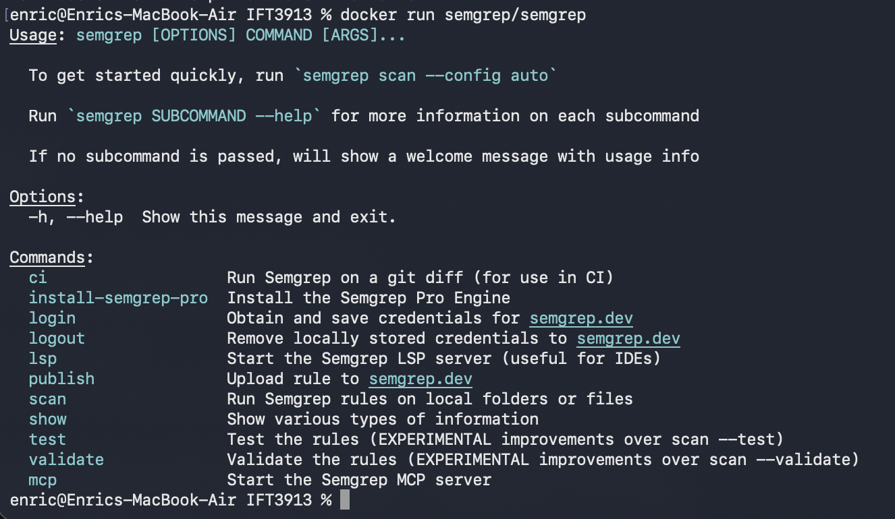

Après je suis tombé sur cette erreur de volume

```
docker run semgrep/semgrep semgrep scan --config auto
```

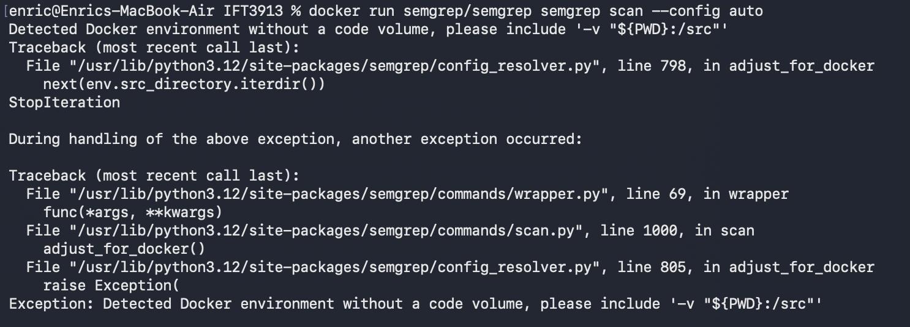

que finalement, j'ai pu régler en montant le volume du repo local dans le container docker.

```
docker run --rm -v "${PWD}:/src" semgrep/semgrep semgrep scan --config auto
```

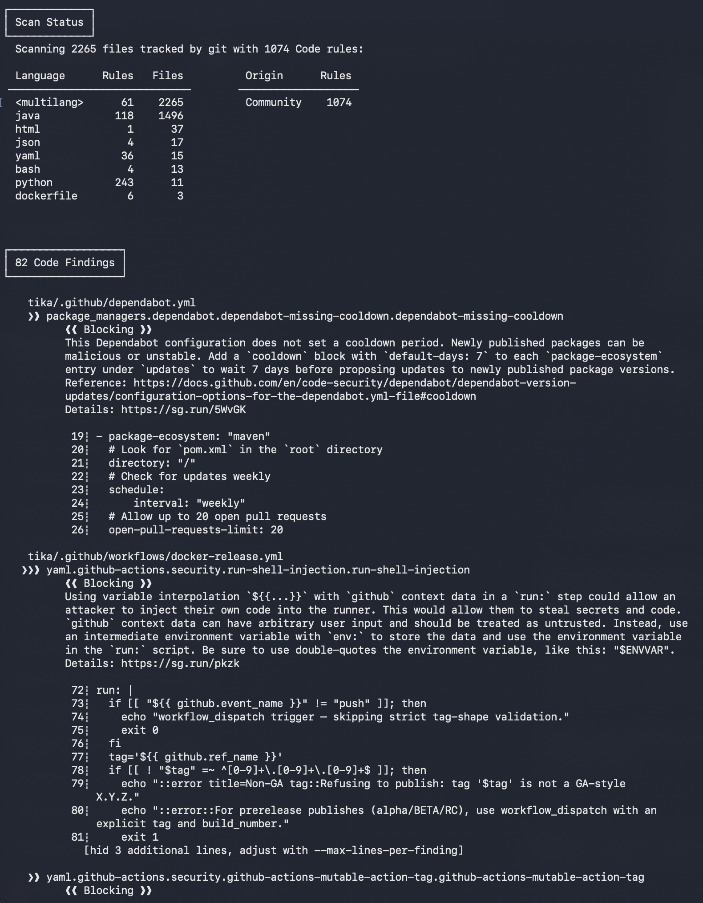

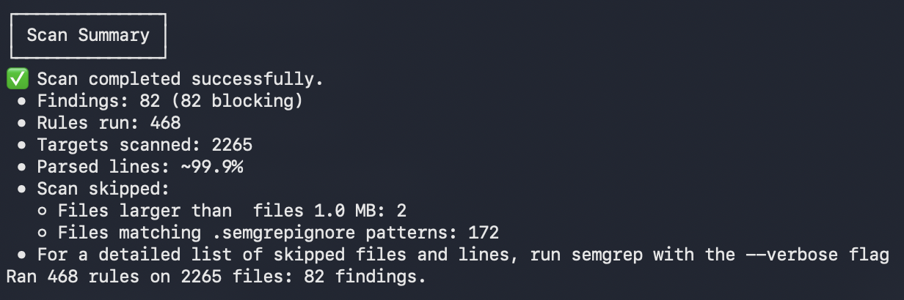

Docs:
https://docs.semgrep.dev/getting-started/cli

### 1.2 Problemes dans le workflow

On peut faire un scan bloquant avec `--error` mais

On aura un problème dans le workflow si deja le repo initial flag des erreurs…

Donc j'ai ajouté le scan dans le workflow de build jdk21 et jdk25 juste au dessus de la job de build (le workflow jdk17 est désactivé, donc je me suis dit que ce n'était pas nécessaire de scanner pour ce workflow).

```
jobs:
  semgrep:
    name: semgrep
    runs-on: ubuntu-latest
    container:
      image: semgrep/semgrep
    steps:
      - uses: actions/checkout@v6
      - run: semgrep scan --config auto --error

  build:
    ...
```

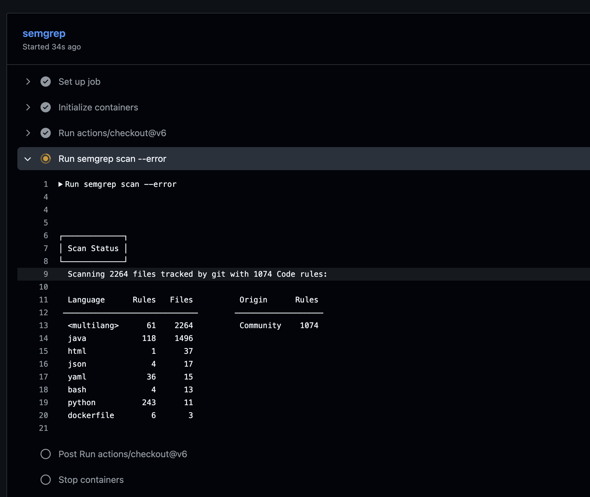

Par contre comme j'avais deviné le workflow échoue, dû aux erreurs déjà présentes dans le repo.
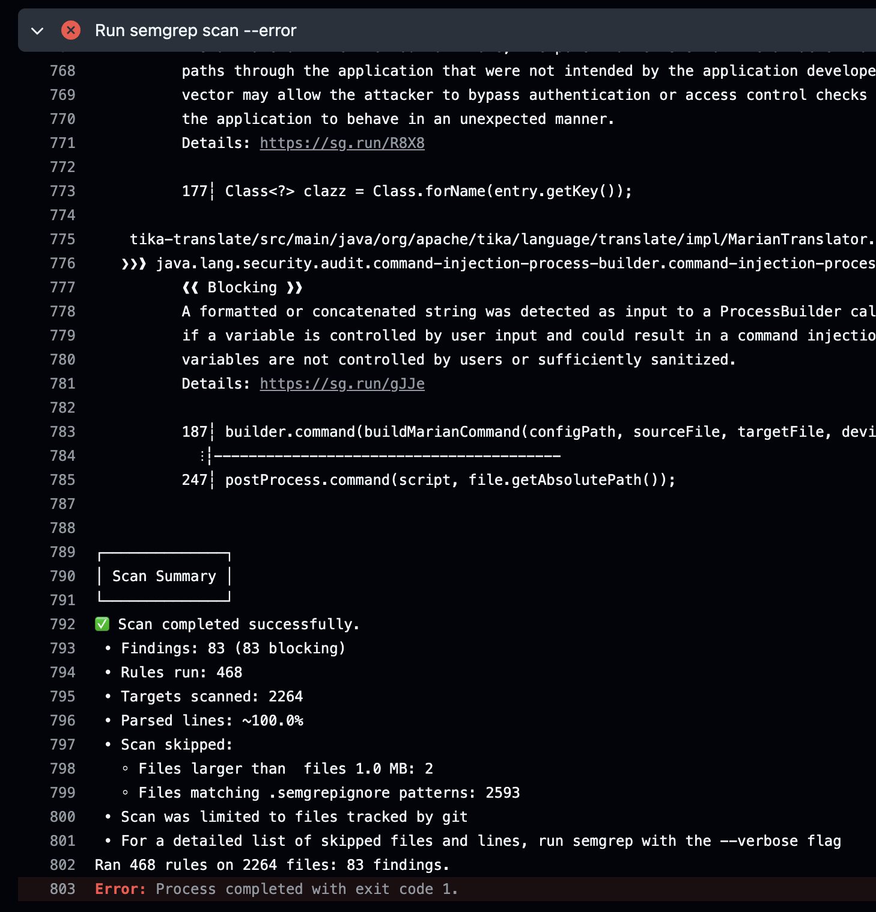

Pour analyser rapidement les types d’erreurs déjà présents, j’ai passé le output dans claude, et il y avait beaucoup trop d'erreurs pour que je puisse tous les corriger.
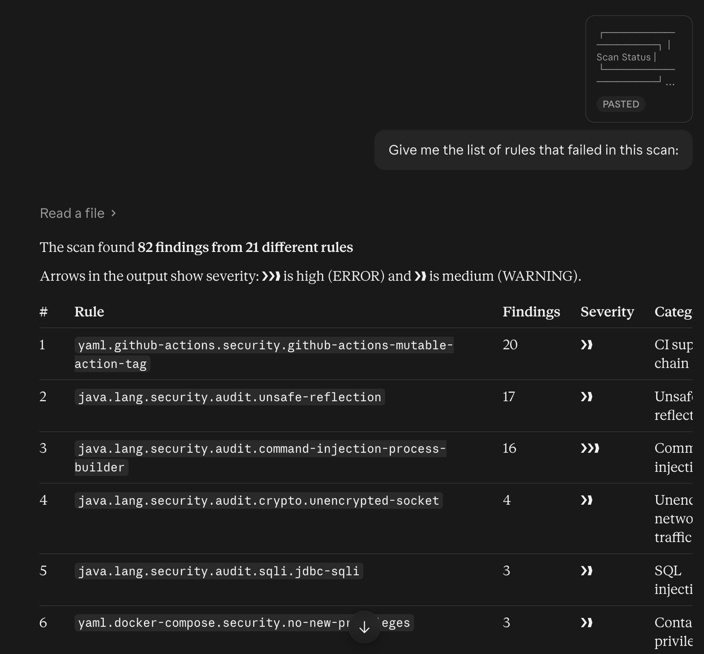

J'ai donc trouvé en ligne qu'on peut utiliser `--baseline-commit` pour ne scanner que les fichiers modifiés depuis un commit de référence, et donc ne pas bloquer le workflow à cause des erreurs déjà présentes, j'ai donc pris le commit le plus récent et fetch tous les commits dans le workflow (`fetch-depth: 0`).

```yaml
steps:
    - uses: actions/checkout@v6
      with:
          fetch-depth: 0
    - run: semgrep scan --config auto --error --baseline-commit 521a5225a2dbad00c5ba9d70ee2dfc83d9bbf0c3
```

### 1.3 Test du workflow

Pour tester le tout, je suis allé sur le site de semgrep pour trouver un exemple de vulnérabilité que je pourrais reproduire dans le codebase, et j'ai trouvé un exemple de token JWT hardcodé qui me semblait le plus simple.
https://semgrep.dev/p/java
https://semgrep.dev/playground/r/java.java-jwt.security.jwt-hardcode.java-jwt-hardcoded-secret?editorMode=advanced

J'ai généré un jwt basique (`https://www.jwt.io/`) que j’ajoute dans un commit et quand on push,

Ça fonctionne!
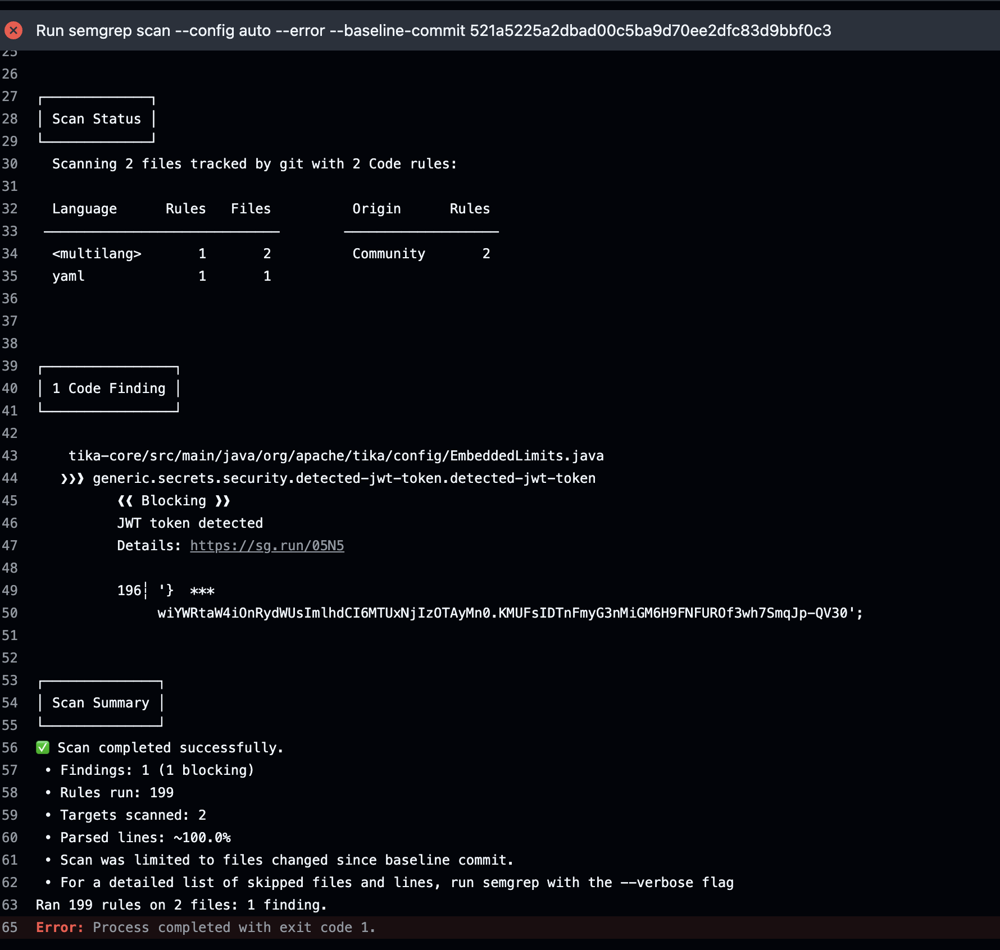

## 2. Vulnérabilités Tika

### 2.1 Choix des vulnérabilités

Pour la création des vulnérabilités je me suis surtout basé sur les tests présents sur le site de semgrep pour détecter les vulnérabilités que j’ai reproduit dans les endroits de la codebase qui réutilisaient du hashing, crypto, random, etc.

#### Détection de l'algorithme MD5 qui est faible

https://semgrep.dev/playground/r/java.lang.security.audit.crypto.use-of-md5.use-of-md5?editorMode=structure

J'ai ajouté un fallback dans `newMessageDigest`. S'il y a une erreur pour sélectionner l'algorithme de hash, MD5 est utilisé par défaut.

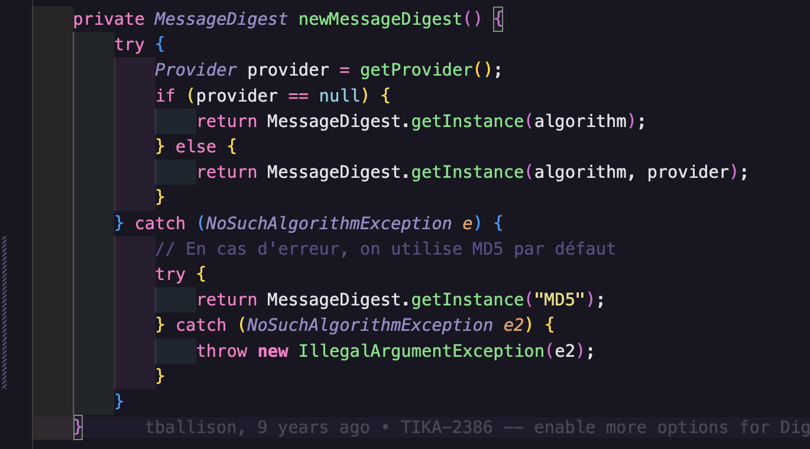

#### Détection de l'algorithme de chiffrement DES qui est obsolète

https://semgrep.dev/playground/r/java.lang.security.audit.crypto.des-is-deprecated.des-is-deprecated?editorMode=structure

J'ai modifié le `parse` de `CryptoParser` pour que DES en mode ECB soit utilisé par défaut.

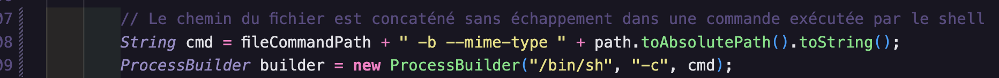

#### Détection d'une injection de commande dans un ProcessBuilder

https://semgrep.dev/playground/r/java.lang.security.audit.command-injection-process-builder.command-injection-process-builder?editorMode=structure

Dans `FileCommandDetector`, j'ai remplacé les arguments échappés par une seule commande qui concatène le chemin du fichier et qui est exécutée à travers `/bin/sh -c`.

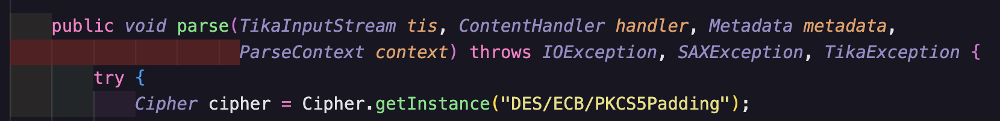

#### Détection d'un parseur XML vulnérable aux attaques XXE

https://semgrep.dev/playground/r/java.lang.security.audit.xxe.documentbuilderfactory-disallow-doctype-decl-missing.documentbuilderfactory-disallow-doctype-decl-missing?editorMode=advanced&view=code

J'ai ajouté dans `XMLReaderUtils` une méthode `badBuilderFactory` qui crée un `DocumentBuilderFactory` et lui applique une feature quelconque (`somethingElse`) au lieu de `disallow-doctype-decl` (comme dans l’exemple du lien).

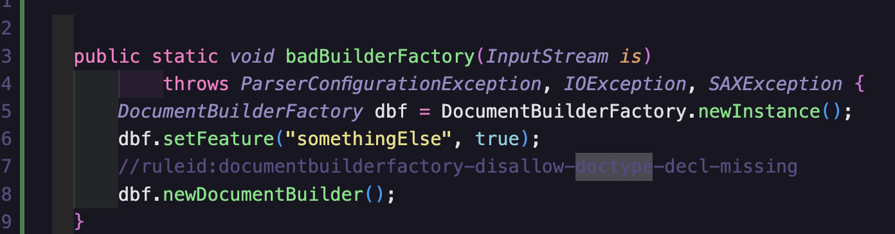

#### Détection d'une désérialisation d'objet non sécuritaire

https://semgrep.dev/playground/r/java.lang.security.audit.object-deserialization.object-deserialization?editorMode=structure

J'ai ajouté dans `ParseContext` une méthode `deserialize` qui reconstruit l'objet avec un `ObjectInputStream`, sans filtrer les classes.

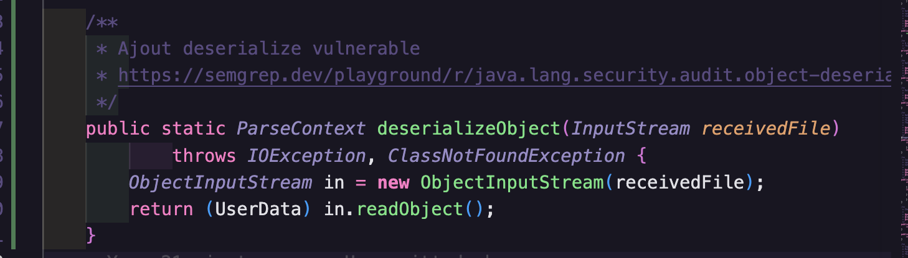

#### Détection d'un token JWT laissé dans le code

https://semgrep.dev/playground/r/generic.secrets.security.detected-jwt-token.detected-jwt-token?editorMode=structure

Dans `TikaInputStream`, j'ai ajouté une constante qui contient un token JWT écrit en dur, et ce token est envoyé dans l'en-tête `Authorization` de chaque requête faite par `get(URL)`.

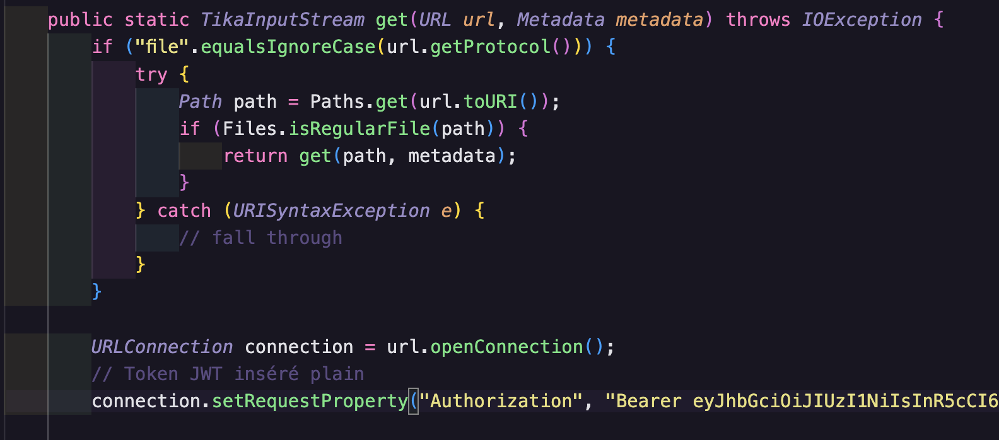

#### Détection d'un générateur aléatoire faible

https://semgrep.dev/playground/r/java.lang.security.audit.crypto.weak-random.weak-random?editorMode=structure

Dans le `createTempFile` de `TemporaryResources`, j'ai remplacé `Files.createTempFile` par un nom de fichier temporaire généré avec `new Random().nextInt()`, qui est prévisible.

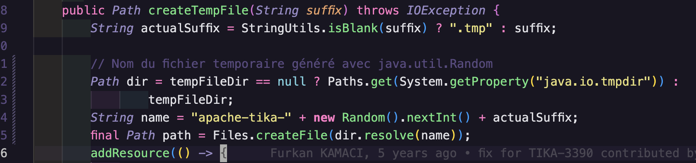

### 2.2 Test et comparaison

Apres un push, les workflow pour compiler le projet échouent bien:

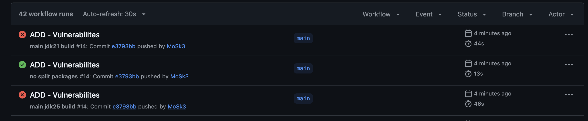

#### Rapport avant

```
Run semgrep scan --config auto --error --baseline-commit ea8902664134ba59c84084ec93e85e240d35a1d2


┌─────────────┐
│ Scan Status │
└─────────────┘
  Scanning 2 files tracked by git with 1074 Code rules:

  Language      Rules   Files          Origin      Rules
 ─────────────────────────────        ───────────────────
  <multilang>      47       2          Community    1074
  yaml             35       2

  Current version has 6 findings.

Creating git worktree from 'ea8902664134ba59c84084ec93e85e240d35a1d2' to scan baseline.
  Will report findings introduced by these commits (may be incomplete for shallow checkouts):
    * a3430cd94 MOD - Update workflows to recent commit


┌─────────────┐
│ Scan Status │
└─────────────┘
  Scanning 2 files tracked by git with 1 Code rule:
  Scanning 2 files.


┌──────────────┐
│ Scan Summary │
└──────────────┘
✅ Scan completed successfully.
 • Findings: 0 (0 blocking)
 • Rules run: 82
 • Targets scanned: 2
 • Parsed lines: ~100.0%
 • Scan was limited to files changed since baseline commit.
 • For a detailed list of skipped files and lines, run semgrep with the --verbose flag
Ran 82 rules on 2 files: 0 findings.
(need more rules? `semgrep login` for additional free Semgrep Registry rules)

If Semgrep missed a finding, please send us feedback to let us know!
See https://semgrep.dev/docs/reporting-false-negatives/
```

#### Rapport apres

```
    tika-core/src/main/java/org/apache/tika/detect/FileCommandDetector.java
   ❯❯❱ java.lang.security.audit.command-injection-process-builder.command-injection-process-builder
          ❰❰ Blocking ❱❱
          A formatted or concatenated string was detected as input to a ProcessBuilder call. This is dangerous
          if a variable is controlled by user input and could result in a command injection. Ensure your
          variables are not controlled by users or sufficiently sanitized.
          Details: https://sg.run/gJJe

          109┆ ProcessBuilder builder = new ProcessBuilder("/bin/sh", "-c", cmd);

    tika-core/src/main/java/org/apache/tika/digest/InputStreamDigester.java
    ❯❱ java.lang.security.audit.crypto.use-of-md5.use-of-md5
          ❰❰ Blocking ❱❱
          Detected MD5 hash algorithm which is considered insecure. MD5 is not collision resistant and is
          therefore not suitable as a cryptographic signature. Use HMAC instead.
          Details: https://sg.run/ryJn

           ▶▶┆ Autofix ▶ "SHA-512"
           76┆ return MessageDigest.getInstance("MD5");

    tika-core/src/main/java/org/apache/tika/io/TemporaryResources.java
    ❯❱ java.lang.security.audit.crypto.weak-random.weak-random
          ❰❰ Blocking ❱❱
          Detected use of the functions `Math.random()` or `java.util.Random()`. These are both not
          cryptographically strong random number generators (RNGs). If you are using these RNGs to create
          passwords or secret tokens, use `java.security.SecureRandom` instead.
          Details: https://sg.run/NwBp

           94┆ String name = "apache-tika-" + new Random().nextInt() + actualSuffix;

    tika-core/src/main/java/org/apache/tika/io/TikaInputStream.java
   ❯❯❱ generic.secrets.security.detected-jwt-token.detected-jwt-token
          ❰❰ Blocking ❱❱
          JWT token detected
          Details: https://sg.run/05N5

          220┆ connection.setRequestProperty("Authorization", "***
               .eyJzdWIiOiIxMjM0NTY3ODkwIiwibmFtZSI6IkpvaG4gRG9lIiwiaWF0IjoxNTE2MjM5MDIyfQ.SflKxwRJSMeKKF2
               QT4fwpMeJf36POk6yJV_adQssw5c");

    tika-core/src/main/java/org/apache/tika/parser/CryptoParser.java
    ❯❱ java.lang.security.audit.crypto.ecb-cipher.ecb-cipher
          ❰❰ Blocking ❱❱
          Cipher in ECB mode is detected. ECB mode produces the same output for the same input each time which
          allows an attacker to intercept and replay the data. Further, ECB mode does not provide any
          integrity checking. See https://find-sec-bugs.github.io/bugs.htm#CIPHER_INTEGRITY.
          Details: https://sg.run/Ro9K

           75┆ Cipher cipher = Cipher.getInstance("DES/ECB/PKCS5Padding");

    ❯❱ java.lang.security.audit.crypto.des-is-deprecated.des-is-deprecated
          ❰❰ Blocking ❱❱
          DES is considered deprecated. AES is the recommended cipher. Upgrade to use AES. See
          https://www.nist.gov/news-events/news/2005/06/nist-withdraws-outdated-data-encryption-standard for
          more information.
          Details: https://sg.run/5Q73

           ▶▶┆ Autofix ▶ "AES/GCM/NoPadding"
           75┆ Cipher cipher = Cipher.getInstance("DES/ECB/PKCS5Padding");

    tika-core/src/main/java/org/apache/tika/parser/ParseContext.java
    ❯❱ java.lang.security.audit.object-deserialization.object-deserialization
          ❰❰ Blocking ❱❱
          Found object deserialization using ObjectInputStream. Deserializing entire Java objects is dangerous
          because malicious actors can create Java object streams with unintended consequences. Ensure that
          the objects being deserialized are not user-controlled. If this must be done, consider using HMACs
          to sign the data stream to make sure it is not tampered with, or consider only transmitting object
          fields and populating a new object.
          Details: https://sg.run/Ek0A

           69┆ ObjectInputStream in = new ObjectInputStream(receivedFile);

    tika-core/src/main/java/org/apache/tika/utils/XMLReaderUtils.java
   ❯❯❱ java.lang.security.audit.xxe.documentbuilderfactory-disallow-doctype-decl-missing.documentbuilderfactory-
       disallow-doctype-decl-missing
          ❰❰ Blocking ❱❱
          DOCTYPE declarations are enabled for this DocumentBuilderFactory. This is vulnerable to XML external
          entity attacks. Disable this by setting the feature "http://apache.org/xml/features/disallow-
          doctype-decl" to true. Alternatively, allow DOCTYPE declarations and only prohibit external entities
          declarations. This can be done by setting the features "http://xml.org/sax/features/external-
          general-entities" and "http://xml.org/sax/features/external-parameter-entities" to false.
          Details: https://sg.run/PYBz

           ▶▶┆ Autofix ▶ dbf.setFeature("http://apache.org/xml/features/disallow-doctype-decl", true);
              dbf.newDocumentBuilder();
          248┆ dbf.newDocumentBuilder();


┌──────────────┐
│ Scan Summary │
└──────────────┘
✅ Scan completed successfully.
 • Findings: 8 (8 blocking)
 • Rules run: 199
 • Targets scanned: 9
 • Parsed lines: ~100.0%
 • Scan was limited to files changed since baseline commit.
 • For a detailed list of skipped files and lines, run semgrep with the --verbose flag
Ran 199 rules on 9 files: 8 findings.
```

## 3. Rickroll

### 3.1 Premier test

D’abord j'ai ajouter directement dans la condition fail du code pour afficher le rickroll dans le summary du workflow.

```yaml
build:
    runs-on: ubuntu-latest
    timeout-minutes: 60
    strategy:
        matrix:
            java: ["21"]

    steps:
        - uses: actions/checkout@v6
        - name: Set up JDK ${{ matrix.java }}
          uses: actions/setup-java@v5
          with:
              distribution: "temurin"
              java-version: ${{ matrix.java }}
              cache: "maven"
        - name: Build with Maven
          run: mvn clean test install javadoc:aggregate -Pci -B "-Dorg.slf4j.simpleLogger.log.org.apache.maven.cli.transfer.Slf4jMavenTransferListener=warn"

        - name: Rickroll on failure
          if: failure()
          run: |
              {
                echo "## Never gonna give you up, never gonna let you down!"
                echo ""
                echo "[](https://www.youtube.com/watch?v=dQw4w9WgXcQ)"
              } >> "$GITHUB_STEP_SUMMARY"
```

j'ai ajouté un test avec assertEquals(1, 2) dans `TikaDetectionTest.java` pour forcer les tests à échouer et voir si le rickroll s'affiche dans le summary du workflow, ce qui a bien fonctionné.

```
  @Test
  public void testRickroll() {
      assertEquals(1, 2);
  }
```

### 3.2 Action réutilisable

J'ai donc ensuite créer une action réutilisable (format que j'ai pris en partie de l'exemple donné de rickroll random)

```yaml
name: "RickRoll"
description: "Make GitHub rick-roll innocent people on test fail. Inspired by : https://github.com/TejasvOnly/random-rickroll/blob/master/action.yml"
author: "Enric Soldevila "
runs:
    using: "composite"
    steps:
        - name: Rickroll
          shell: bash
          run: |
              {
                echo "## Never gonna give you up, never gonna let you down!"
                echo ""
                echo "[](https://www.youtube.com/watch?v=dQw4w9WgXcQ)"
              } >> "$GITHUB_STEP_SUMMARY"
```

et j'ai ajouté dans le workflow de build jdk21 et jdk25 l'utilisation de cette action réutilisable.

```yaml
- name: Rickroll on failure
  if: failure()
  uses: ./.github/actions/rickroll
```

Avec encore le test erroné dans `TikaDetectionTest.java`, le rickroll s'affiche bien dans le summary du workflow :
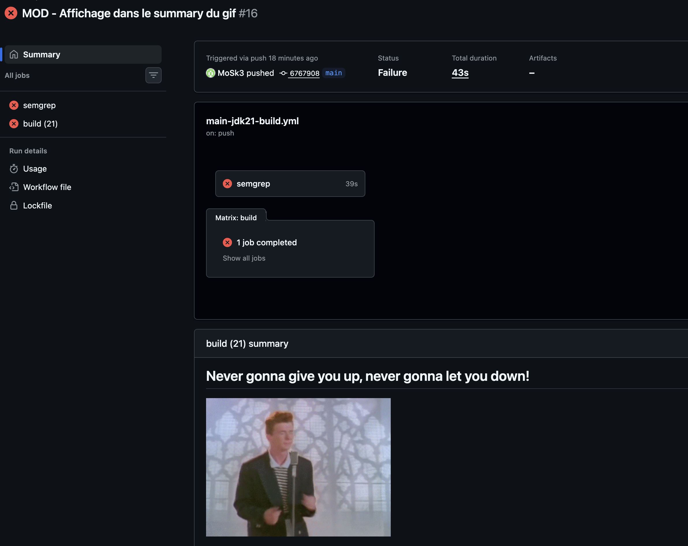

## 4. Conclusion

En conclusion, c'était un peu pénible au début de trouver comment faire fonctionner semgrep localement, car tout demande maintenant un compte!!! Mais sinon après ça l'ajout dans les workflow s'est fait assez bien!
